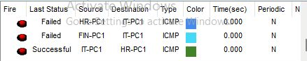

# Enterprise Network Security Lab

A Cisco Packet Tracer lab (CCNA level) that models a small company network with HR, Finance, IT, and server segments. It demonstrates inter-VLAN routing, DHCP, department isolation with extended ACLs, an internal DNS and web server, SSH v2 management restricted to the IT VLAN, and Port Security.

Open the included [Enterprise-Network-CCNA.pkt](Enterprise-Network-CCNA.pkt) to run the configured lab in Cisco Packet Tracer 8.2.2. A Cisco 2911 router provides inter-VLAN routing over an 802.1Q trunk to a Cisco 2960 core switch. Two Cisco 2960 access switches connect six PCs and an internal web and DNS server.

## IP plan

| VLAN | Purpose | Subnet | Default gateway |
| --- | --- | --- | --- |
| 10 | HR | 192.168.10.0/24 | 192.168.10.1 |
| 20 | Finance | 192.168.20.0/24 | 192.168.20.1 |
| 30 | IT and device management | 192.168.30.0/24 | 192.168.30.1 |
| 40 | Intranet server | 192.168.40.0/24 | 192.168.40.1 |
| 999 | Unused native VLAN on trunks | n/a | n/a |

The switch management addresses are 192.168.30.2 (SW1-Core), 192.168.30.3 (SW2), and 192.168.30.4 (SW3). The web and DNS server uses 192.168.40.10.

## Access policy

| From | To | Result |
| --- | --- | --- |
| HR | Finance | Blocked |
| Finance | HR | Blocked |
| HR, Finance | IT (VLAN 30) | Blocked: they cannot initiate connections |
| IT | HR, Finance | Allowed |
| HR, Finance, IT | Server (VLAN 40) | Allowed |
| All departments | DHCP and DNS | Allowed |
| SSH to the router and switches | | Only from VLAN 30 |

## Configuration

- **DHCP** on R1 assigns addresses, gateways, and DNS to all six PCs.
- **Extended ACLs** on the HR and Finance subinterfaces (`HR_IN` and `FINANCE_IN`) isolate the departments. HR and Finance cannot initiate connections to each other or to the IT VLAN. Replies to sessions started by IT are allowed (`echo-reply` and `established` rules), so IT can reach HR and Finance for troubleshooting and administration. DHCP requests and access to the server stay available to all departments.
- **DNS and HTTP** on the server provide the internal site at `http://intranet.company.local`.
- **SSH v2** on the router and all three switches is restricted to sources in VLAN 30 by VTY access lists (`SSH_IT_ONLY`).
- **Port Security** allows one sticky MAC address on each PC and server access port. Violations use restrict mode.
- **Trunks** between R1, SW1-Core, SW2, and SW3 use 802.1Q with the unused VLAN 999 as the native VLAN.

## Run the lab

1. Open [Enterprise-Network-CCNA.pkt](Enterprise-Network-CCNA.pkt) in Cisco Packet Tracer 8.2.2 and wait for the links to converge.
2. From IT-PC1, ping HR-PC1 and FIN-PC1 (success). From HR-PC1 or FIN-PC1, ping IT-PC1 (fails), and ping each other (fails). From every PC, ping the server at `192.168.40.10` (success).
3. From a PC in each department, open `http://intranet.company.local` in the simulated browser.
4. From the simulated command prompt on IT-PC1, run `ssh -l admin 192.168.30.2` to connect to SW1-Core. The public, lab-only account is `admin` and the password is `NetLab2026!`. The same lab-only password is used for privileged EXEC access. An SSH attempt from HR-PC1 to SW1-Core times out.

The first ping between devices can fail once while ARP entries are learned. The lab has no Internet connection, ISP, or NAT; use the intranet server for tests.

## Observed test results

| Check | Observed result | Evidence |
| --- | --- | --- |
| Isolation | HR-PC1 and FIN-PC1 cannot ping IT-PC1, while IT-PC1 can ping HR-PC1. | [Isolation](tests/01-IT-Isolation.png) |
| Allowed connections | IT-PC1 can ping FIN-PC1, and HR-PC1 and FIN-PC1 can ping the server. | [Allowed connections](tests/02-Allowed-Connections.png) |
| DHCP | HR-PC1 received 192.168.10.22/24 with gateway 192.168.10.1 and DNS 192.168.40.10. | [HR DHCP](tests/03-HR-DHCP.png) |
| Intranet | HR-PC1 opened `http://intranet.company.local` by hostname. | [HR intranet](tests/04-HR-Intranet.png) |

The remaining behavior (HR and Finance isolation from each other, the SSH restriction, Port Security, and the trunks) is defined in the configuration files below and can be checked in the project file with the commands in the next section.

## Inspect the configuration

Open any router or switch in Packet Tracer, go to the CLI tab, and run:

- `show running-config` for the full configuration
- `show access-lists` on R1 for the ACLs and their match counters
- `show ip dhcp binding` on R1 for the DHCP leases
- `show interfaces trunk` and `show vlan brief` on the switches
- `show port-security` on SW2 and SW3
- `show ip ssh` on any device for the SSH version

## Running configurations

[R1](configs/R1.txt) · [SW1-Core](configs/SW1-Core.txt) · [SW2](configs/SW2.txt) · [SW3](configs/SW3.txt)

These snapshots were exported from the included Packet Tracer project and are a reference, not paste-ready scripts.

### Notes for manual builds

- **Placeholders:** password hashes were replaced with `<LAB_ENABLE_SECRET>` and `<LAB_SSH_SECRET>`. Substitute your own lab values before pasting.
- **Sticky MAC lines:** the switch files contain lines such as `switchport port-security mac-address sticky 0009.7CA6.4EC8`. These are the virtual MAC addresses of the original devices. Delete them in a new build, otherwise the ports will restrict your PCs. Keeping only `switchport port-security mac-address sticky` lets each port learn its own device.
- **SSH keys:** RSA keys are not part of the exported snapshots. On R1 and each switch, set `ip domain-name company.local` and run `crypto key generate rsa modulus 1024` before enabling SSH.
- **End devices:** set all six PCs to DHCP. Give SERVER the static address 192.168.40.10/24 with gateway 192.168.40.1 and DNS 192.168.40.10. Turn on its HTTP and DNS services, and add an A record for `intranet.company.local` pointing to 192.168.40.10.

### Cabling

| Device A | Port A | Device B | Port B |
| --- | --- | --- | --- |
| R1 | GigabitEthernet0/0 | SW1-Core | FastEthernet0/1 |
| SW1-Core | FastEthernet0/23 | SW2 | FastEthernet0/1 |
| SW1-Core | FastEthernet0/24 | SW3 | FastEthernet0/1 |
| SW2 | FastEthernet0/2 | HR-PC1 | FastEthernet0 |
| SW2 | FastEthernet0/3 | HR-PC2 | FastEthernet0 |
| SW2 | FastEthernet0/4 | FIN-PC1 | FastEthernet0 |
| SW3 | FastEthernet0/2 | FIN-PC2 | FastEthernet0 |
| SW3 | FastEthernet0/3 | IT-PC1 | FastEthernet0 |
| SW3 | FastEthernet0/4 | IT-PC2 | FastEthernet0 |
| SW3 | FastEthernet0/5 | SERVER | FastEthernet0 |

## Security note

The credentials in this project are for the lab only. Do not reuse them anywhere else.
